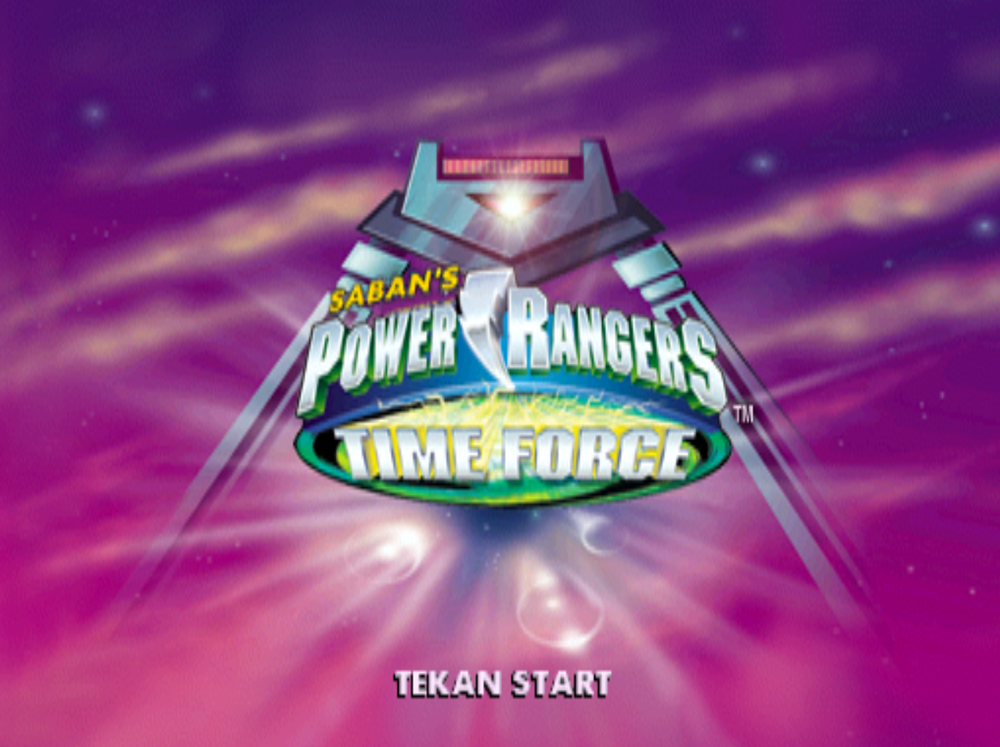

# Power Rangers: Time Force (PS1) - Indonesian Translation

Unofficial Indonesian fan translation for *Power Rangers: Time Force* (PlayStation, THQ, 2001).

The patch rewrites the in-game text tables inside `BIGLUMP.BIN` in place. File size, archive layout and string offsets are unchanged, so the translation can be re-imported into the disc image without rebuilding the filesystem.



## Contents

- [Screenshots](#screenshots)
- [Status](#status)
- [Requirements](#requirements)
- [Compatibility](#compatibility)
- [Usage](#usage)
- [Translation file format](#translation-file-format)
- [BIGLUMP.BIN format](#biglumpbin-format)
- [Translation constraints](#translation-constraints)
- [Contributing](#contributing)
- [Known issues](#known-issues)
- [Credits](#credits)
- [Legal](#legal)

## Screenshots


|  |  |
|  |  |

## Status

| Component | Status |
|---|---|
| Tutorial and mission dialogue (`VOSCRIPT`, 204 strings) | Translated |
| Menus, options, level and arena names | Translated |
| Memory card messages | Translated |
| Credits (job titles only) | Translated |
| Proper nouns, move names, THQ legal text, password codes | Left in English |
| FMV subtitles | Not applicable (not in this file) |
| Text stored as graphics (titles, logos) | Not translated |

399 of 611 strings are modified. The remaining 212 are names, codes and terms intentionally kept as-is.

## Requirements

- A legitimate copy of the game, dumped to `.bin/.cue`
- Python 3.8+
- A tool that can extract and replace a file inside a PS1 image without changing its size (e.g. CDMage, `dumpsxiso`)
- An emulator (DuckStation or similar) or modded hardware

## Compatibility

Developed against a `BIGLUMP.BIN` with the following properties. Other regions or revisions are untested.

```
Size    : 28,647,424 bytes
MD5     : fccd5b8a9044767a5fa4aec820075b89
SHA-1   : 5ec44273ad49e5f9d76f9795cd02ec7130a0d8b5
SHA-256 : add7cdad91e45ed2eef2ea90c86a2d5a6195c12b81c4591f5dbc6e5ad88d4b32
```

Patched output:

```
MD5     : 319814811fcd7edc25c7aa1f1c2e502e
SHA-1   : e699d824b238a55a458cf4ee7bf07d3da3fb5355
SHA-256 : c20840a98be315422c73ef3683da8ab088fc463d3f6c1bd5ed9df4a60d3f1558
```

## Usage

### Option A: script

1. Extract `BIGLUMP.BIN` from your disc image.
2. Verify its hash against the table above.
3. Run:
   ```bash
   python tools/patch_biglump.py BIGLUMP.BIN translation/biglump_strings_ID.csv BIGLUMP_ID.BIN
   ```
4. Replace `BIGLUMP.BIN` in the image with `BIGLUMP_ID.BIN`. The size is identical to the original.

The script is expected to abort if the input hash does not match, or if any translated string exceeds its `max_len`.

### Option B: binary patch

Download the xdelta or PPF patch from the Releases page and apply it to your original `.bin`. Always patch a copy.

## Translation file format

`translation/biglump_strings_ID.csv` (UTF-8, one row per string):

| Column | Description |
|---|---|
| `idx` | String index in the offset table (0-610) |
| `id` | Internal string ID, e.g. `STR__VOSCRIPT_0616` |
| `max_len` | Maximum length in bytes, excluding the null terminator |
| `english` | Original text |
| `indonesia` | Translation |
| `len` | Current length of the translation |

Newlines are written as `\n`.

## BIGLUMP.BIN format

All integers are little-endian.

**Archive header.** The file starts with a table of 8-byte entries, `(offset: u32, size: u32)`. There are 251 entries. Offsets are aligned to 0x800 (one CD-ROM sector).

**String tables.** Entries 0, 1 and 3 (offsets `0x800`, `0x6000`, `0x10800`; size `0x543B` each) are byte-identical English string tables. Entry 2 (`0xB800`, size `0x485D`) has the same layout and holds the string IDs.

```
0x0000  u32        count (611)
0x0004  u32[count] offsets, relative to the start of the entry
0x0990  char[]     null-terminated ASCII strings, packed in index order
```

Strings are stored contiguously, so the slot for string `i` spans `offsets[i]` to `offsets[i+1]`. The patcher writes the translation at the start of the slot and zero-fills the remainder. The offset table is not modified. All three copies are patched.

**Control codes.** `{ } | ~` map to controller button icons. `%d`, `%s` and `%02d` are printf-style placeholders. Both must be preserved exactly.

## Translation constraints

- Length must not exceed `max_len`.
- Keep `\n`, printf placeholders and button glyphs in place and in the same count.
- Use only characters already present in the original strings. The font is limited; avoid `+`, `/`, `#` and accented letters.
- Many tutorial strings are fragments that the engine concatenates (e.g. a sentence, a button name, then a continuation). Translations must read correctly when joined.

## Contributing

1. Edit the `indonesia` column in `translation/biglump_strings_ID.csv`.
2. Make sure `len <= max_len` for every row.
3. Open a pull request, or an issue that lists `idx` and the proposed text.

For rendering bugs, include a screenshot, the emulator and version, and the string `idx`.

## Known issues

- Not tested end to end on every level.
- Some strings are abbreviated to fit `max_len`.
- Padding after shorter strings is null bytes rather than spaces. This is safe if the engine reads strings through the offset table. If text is truncated or corrupted, open an issue.
- Only one game revision has been tested.

## Credits

- The Handsome Guy: [Nopal]
- Original game: THQ / Saban, developed by Climax Group

## Legal

This is a non-commercial fan project and is not affiliated with THQ, Saban or any rights holder of Power Rangers. This repository does not contain any game data, ISO or ROM. You must supply your own legally obtained copy. Do not redistribute patched game images.
